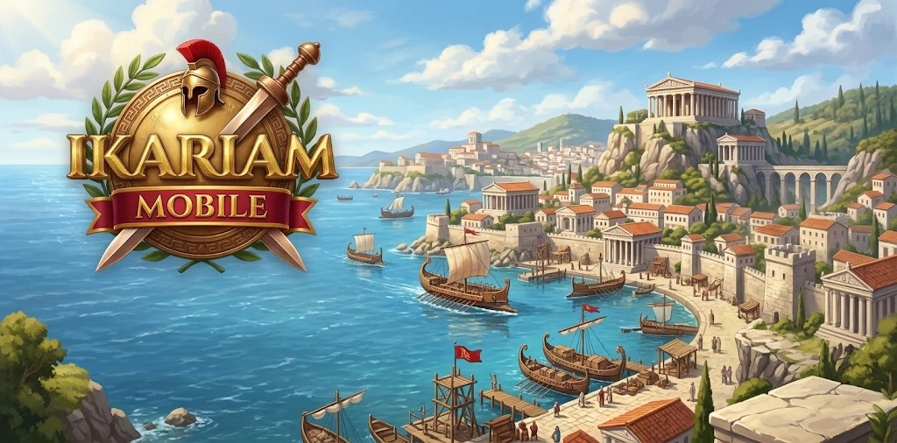
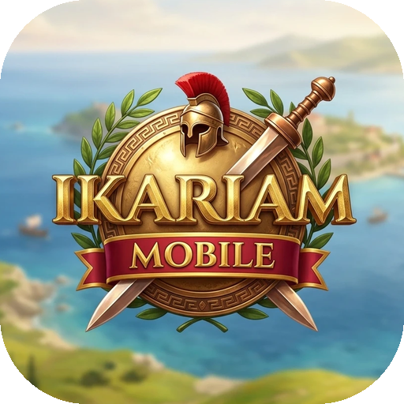
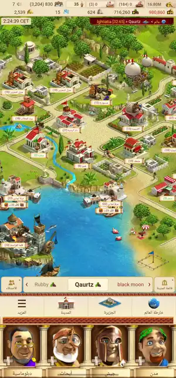
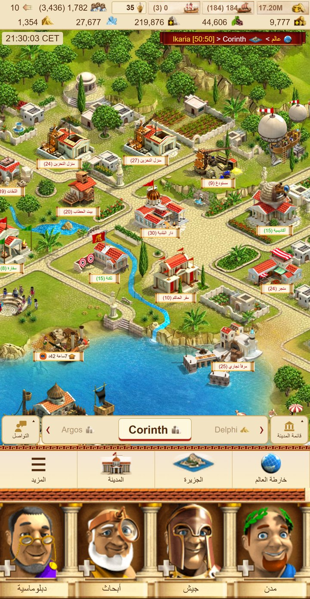
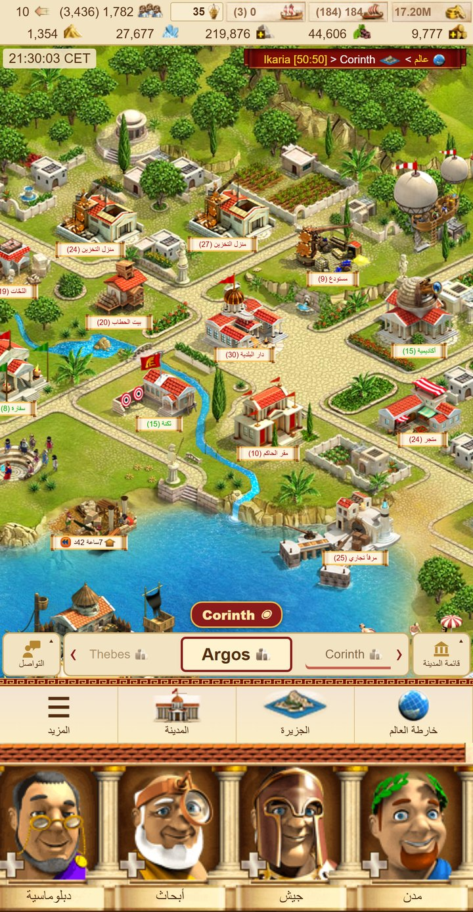
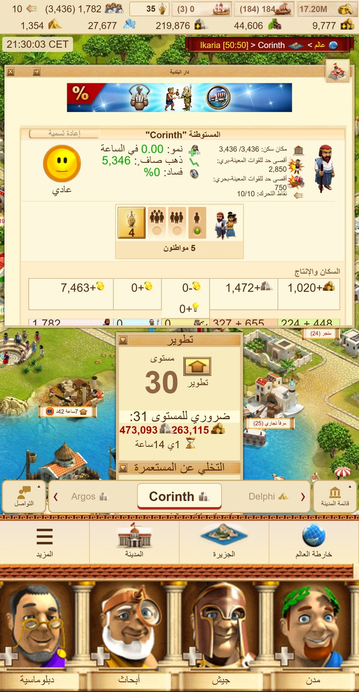
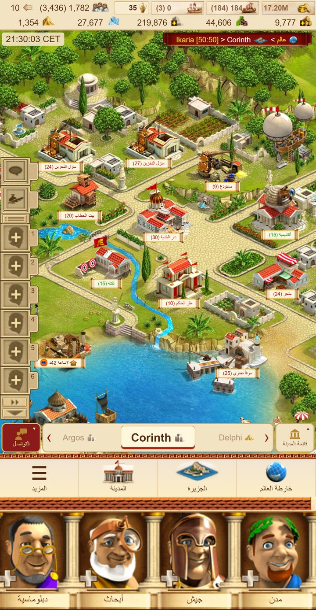
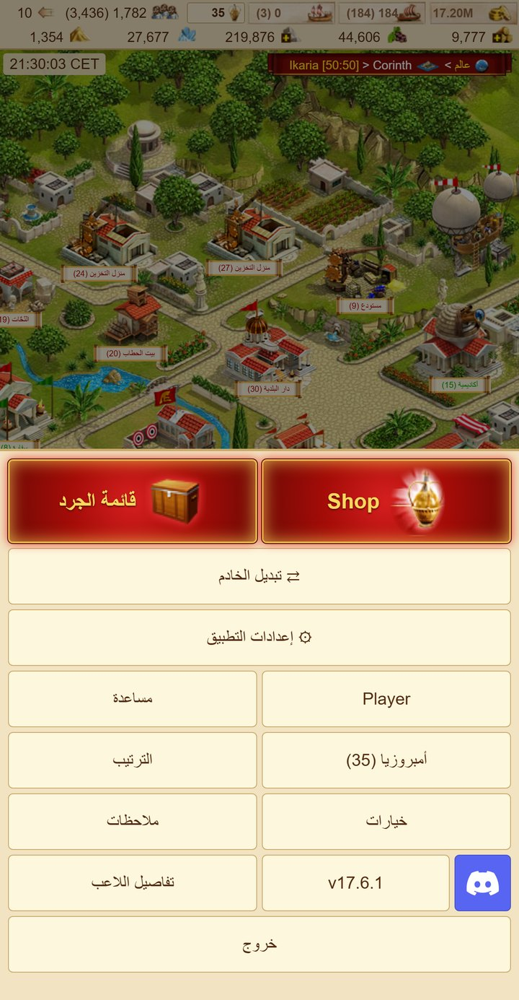
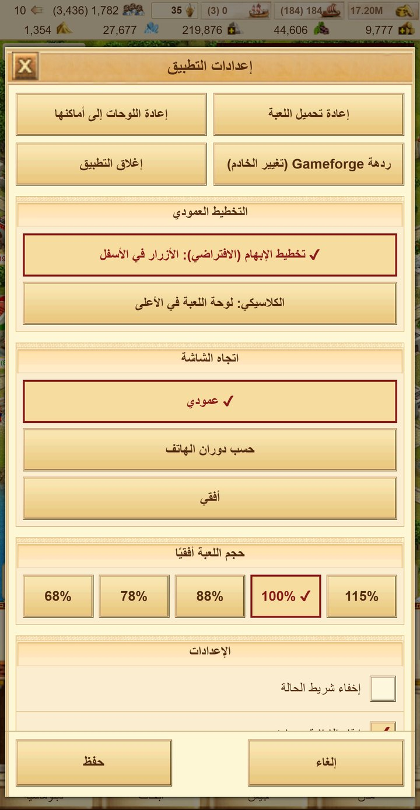

<p align="center"></p>

<p align="center">
<a href="README.md"></a>
&nbsp;

</p>

<div dir="rtl">

<h1 align="center"> إيكاريام موبايل</h1>

<p align="center"><b>العب إيكاريام على هاتفك براحة، بإبهام واحد.</b><br>
اللعبة الحقيقية، مرتّبة لهاتف في الوضع العمودي. مشروع غير رسمي من أحد اللاعبين.</p>

<p align="center">
<a href="https://github.com/sliver301/Ikariam-Mobile-APP/releases/latest"></a>
</p>

<p align="center">

<br><sub>التحكم باللمس في 75 ثانية · <a href="https://github.com/sliver301/Ikariam-Mobile-APP/releases/download/v1.1/Ikariam-Mobile-tutorial-ar.mp4">الفيديو بجودة كاملة</a></sub>
</p>

<p align="center">



</p>
<p align="center">



</p>
<p align="center"><sub>أسماء المدن واللاعب مختلَقة.</sub></p>

## ماذا ستحصل عليه

- 👍 **كل شيء في متناول إبهامك:** شريط رفيع في الأعلى؛ وشريط المدن والمدينة / الجزيرة / خارطة العالم / المزيد والمستشارون في الأسفل.
- 🎡 **عجلة المدن:** مرّر أو حرّك بسرعة بين مدنك، وانقر على مدينة للانتقال إليها.
- 🗺️ **شريط خارطة العالم:** انتقل إلى أي إحداثيات، واحتفظ بقائمة للجزر التي تحفظها.
- 🔔 **تنبيهات الأخبار:** أخبار المستشارين على شاشة القفل، مع نص الخبر نفسه.
- ✋ **لمس مصمَّم للعبة:** اسحب الخريطة، كبّر بإصبعين، اضغط مطوّلاً للمعلومات، وأشرطة تمرير ونقل مبانٍ سهلة.
- 🌍 **لغتك:** يتبع لغة اللعبة (27 لغة)، معكوساً للعربية والعبرية.
- 🔄 **يحدّث نفسه:** يعرض كل إصدار جديد عند فتحه.

كل حركة في اللعبة تأتي من نقرتك أنت: التطبيق لا يلعب بدلاً منك أبداً.

<details>
<summary><b>كل المزايا</b></summary>

**مصمَّم لإبهامك (الوضع العمودي)**
- شريط رفيع في الأعلى (الذهب، السفن، الأمبروزيا، السكان، نقاط الحركة، الموارد، ساعة الخادم)؛ وشريط المدن والمدينة / الجزيرة / خارطة العالم / المزيد والمستشارون في الأسفل، في متناول إبهامك.
- **عجلة المدن:** مرّر شريط المدن، أو حرّكه بسرعة ليدور بين مدنك؛ يتوقف دائماً ومدينةٌ في الوسط، ولا يغيّر المدينة وحده. انقر على المدينة المحاطة بإطار، أو على المدينة المجاورة لها، للانتقال إليها فوراً. مدينتك الحالية تبقى مُعلَّمة، وعلامةٌ فوق الشريط تعيدك إليها. يمكنك الشعور بنقرات خفيفة أثناء الدوران (ويمكن إيقافها).
- زرّا **قائمة المدينة** و**التواصل**: اضغط لإظهار العمود أو إخفائه، أو اسحب للأعلى وارفع إصبعك عند ما تريد. إذا كنت في تحالف، يضم التواصل دردشة التحالف ورسالة التحالف فوق أصدقائك.
- نوافذ اللعبة تملأ عرض الشاشة؛ ويمكن سحب النوافذ واللوحات الجانبية من شريطها العلوي، وتتذكر مكانها. دردشة التحالف بعرض الشاشة ونصها ضعف حجم نص اللعبة.
- تُفتح المدن على دار البلدية؛ وعرض الجزيرة وخارطة العالم يُفتحان ومدينتك / جزيرتك في الوسط.
- **شريط خارطة العالم:** خانتا X / Y (زر "التالي" ينتقل إلى الخانة الأخرى، ثم "انتقال" يأخذك إليها ويحدد الجزيرة) وقائمة اختصارات الجزر الخاصة باللعبة كقائمة منسدلة: جزر مدنك، ثم الجزر التي حفظتها، ولكلٍّ منها موردها واسمها وإحداثياتها. ★ يحفظ الجزيرة المحددة (باسم من اختيارك)، و✕ يحذف واحدة.
- **المزيد:** المتجر والمخزن وديسكورد وتبديل الخادم (مباشرةً إلى أي خادم تلعب عليه من هذا الهاتف) وروابط اللعبة و**إعدادات التطبيق**: نافذة بأسلوب اللعبة فيها التخطيط واتجاه الشاشة والمفاتيح وإعادة التحميل والردهة والشرح وغير ذلك.
- أي خادم وأي لغة: يتبع التطبيق اللغة التي تختارها في خيارات اللعبة (27 لغة)، معكوساً للعربية والعبرية.
- قائمة المدن > تعديل الترتيب: ترتيبك الخاص للمدن، يُحفظ في الترتيب المخصص داخل اللعبة فيسري على كل أجهزتك.
- يتوفر أيضاً التخطيط الكلاسيكي (لوحة اللعبة في الأعلى) والوضع الأفقي.

**التحكم باللمس**
- النقر = نقرة. الضغط المطوّل = معلومات اللعبة عند التمرير (على الذهب أو أحد الموارد تظهر كبيرة فوق شريط المدن مباشرةً، وأي لمسة أو زر الرجوع يغلقها). الضغط ثم التحريك = سحب.
- اسحب المدينة والجزيرة بإصبع واحد؛ والتكبير بإصبعين أو بالنقر مرتين يكبّر الخريطة فقط، لا الأشرطة.
- إصبعان داخل نافذة (تقرير معركة مثلاً) يكبّران محتواها.
- خانات الأرقام تفتح لوحة الأرقام (بالأرقام الإنجليزية دائماً)، والمؤشر بعد آخر رقم.
- أشرطة التمرير: أمسك المقبض من مساحة واسعة حوله أو اسحب على طول الشريط؛ ونقرة اهتزاز خفيفة مع كل خطوة.
- إعادة ترتيب المباني: يتحرك المبنى تحت إبهامك؛ وفوق المكان المتاح تنبض دائرة خضراء ويهتز الهاتف. زر الحفظ يحفظ، وزر الرجوع يلغي.
- زر الرجوع يغلق ما في الأعلى؛ وعندما لا يكون شيء مفتوحاً، اضغطه مرتين للخروج من التطبيق.

**شرح التحكم باللمس**
- يُعرض مرة واحدة بعد التثبيت، ويبقى دائماً في المزيد > إعدادات التطبيق. يعمل على نسخة محفوظة من مدينة (بلا أي بيانات شخصية)، بملء الشاشة، ولا يستطيع لمس حسابك. اضغط رجوع مرتين لإنهائه.

</details>

<details>
<summary><b>تنبيهات الأخبار</b> (اختيارية، مفعّلة افتراضياً)</summary>

- كل دقيقة يتحقق من كل خادم أنت مسجّل الدخول فيه بحثاً عن أخبار المستشارين (المدن، الجيش، الأبحاث، الدبلوماسية) ويهتز الهاتف (بلا صوت). يعرض التنبيه الخبر نفسه (المدينة والنص) مع صورة المستشار؛ انقر عليه لفتح ذلك الخادم عند ذلك المستشار. والأخبار التي قرأها التطبيق نيابةً عنك تبقى مميَّزة في اللعبة حتى تطّلع عليها.
- لا يسجّل الدخول وحده أبداً. إذا خرجت من حسابك (باللعب على الحاسوب مثلاً)، يخبرك بذلك مرة واحدة مع زر "إعادة الاتصال".
- ملاحظة: قد لا تسمح قواعد اللعبة بالتحقق في الخلفية؛ استخدمه على مسؤوليتك. يمكنك إيقافه من إعدادات التطبيق.

</details>

<details>
<summary><b>كيف يعمل</b> · التثبيت · التحديثات</summary>

هو متصفح مخصص: يفتح موقع إيكاريام الحقيقي ولا يغيّر إلا ترتيب الصفحة وطريقة وصول اللمس إليها. كل حركة في اللعبة تأتي من نقرتك أنت. وهو مشروع غير رسمي من أحد اللاعبين، ولا علاقة له بشركة Gameforge.

**التثبيت:** حمّل ملف APK من [أحدث إصدار](https://github.com/sliver301/Ikariam-Mobile-APP/releases/latest)، وافتحه على هاتفك واسمح بالتثبيت من ذلك التطبيق عندما يطلب أندرويد ذلك. يحتاج أندرويد 12 أو أحدث. سجّل دخولك بحساب Gameforge كالمعتاد واختر خادمك، وسيتذكره التطبيق.

**التحديثات:** يتحقق التطبيق من هذه الصفحة عند فتحه، ويعرض عليك تنزيل أي إصدار أحدث وتثبيته. أرقام الإصدارات تتبع اللعبة: التطبيق 1.17.6.1 مصنوع لإصدار اللعبة 17.6.1 (و1.17.6.1.1 هو الإصدار الثاني للتطبيق لنفس إصدار اللعبة). وعندما تنتقل اللعبة إلى إصدار جديد، يخبرك التطبيق بذلك مرة واحدة، تحسّباً لأي اختلاف في الشكل حتى يلحق به التطبيق.

</details>

<details>
<summary><b>للمطوّرين</b></summary>

<div dir="ltr">

```
app/src/main/java/com/islam/ikariamtouch/   Android side (WebView, back button, settings, alerts, tutorial)
app/src/main/assets/enhance.js               Page script: layout, touch handling, map camera, town wheel
app/src/main/assets/i18n.txt                 The app's own words in every language
app/src/main/assets/tutorial/                The tutorial's captions (its saved town is built locally)
art/                                         Scripts to build the extended city background
build.bat / build_public.bat                 Local build / the build for releases
```

</div>

المتطلبات: JDK 17 أو أحدث (يعمل JBR المرفق مع Android Studio)، وAndroid SDK (compileSdk 37)، وGradle 9.6. شغّل الأمر `gradle assembleDebug` أو عدّل المسارات في `build.bat`؛ ويُكتب ملف APK في `app/build/outputs/apk/debug/app-debug.apk`.

صور اللعبة وصفحاتها ليست في هذا المستودع: خلفية المدينة الموسّعة (`app/src/main/assets/art/`) والمدينة المحفوظة للشرح (`app/src/main/assets/tutorial/tut_*.html`) تُبنيان محلياً من لعبة قيد التشغيل، وبدونهما يستخدم التطبيق حافة مدينة معكوسة والشرح المكتوب. نسخة الإصدار (APK) تتضمنهما.

**خلفية المدينة الموسّعة:** والتطبيق يعمل على هاتف (مع تصحيح USB)، اجمع مربعات أرض المدينة في `art/source/`، وشغّل `art/make_gemini_inputs.ps1`، واطلب من نموذج صور أن يملأ المنطقة الرمادية إلى الأعلى، واحفظ النتيجة في `art/generated/` ثم ثبّتها بالأمر `art/install_generated.ps1 -Picture art/generated/<file>`.

أيقونة التطبيق عمل أصلي (يبنيها `art/make_icon.py` من `art/icon_source.png`).

</details>

<sub>إيكاريام وصورها علامات تجارية / ملكية لشركة Gameforge 4D GmbH. هذا المشروع يقدّم فقط غلاف متصفح للاستخدام الشخصي؛ يُرجى الالتزام بشروط استخدام اللعبة.</sub>

</div>
