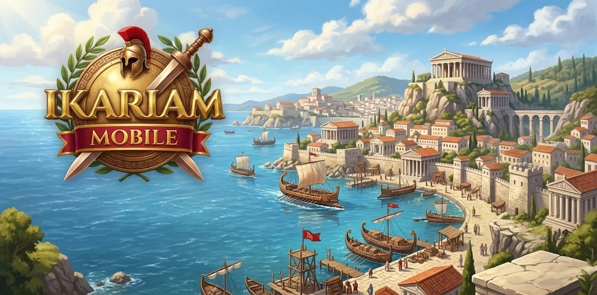
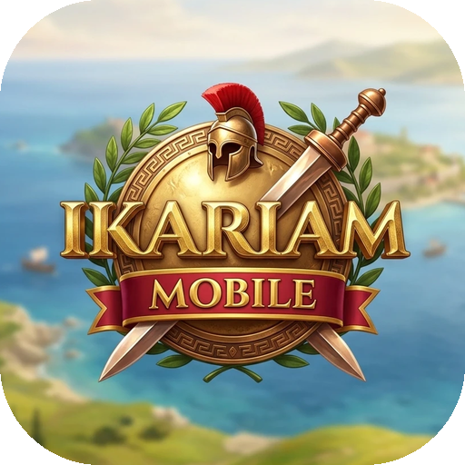
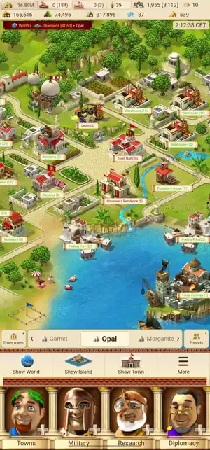
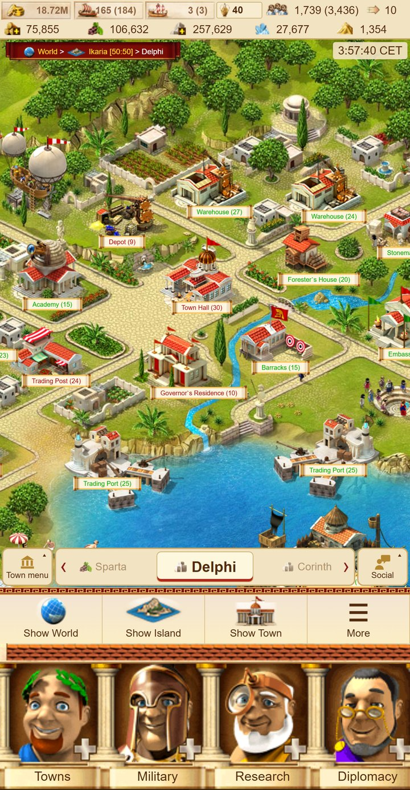
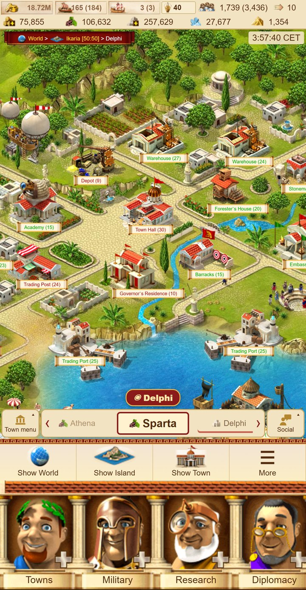
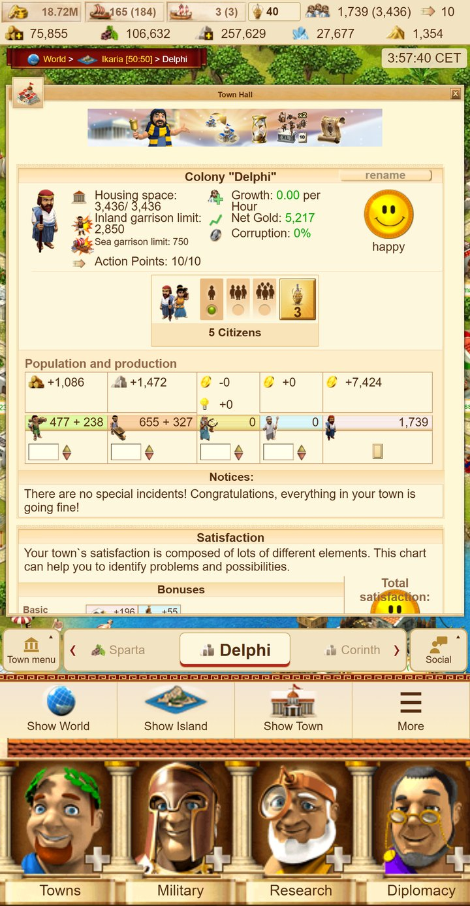
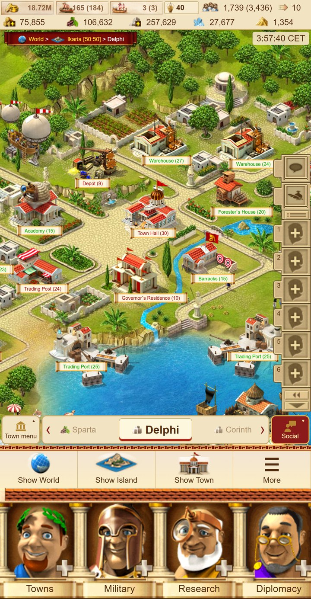
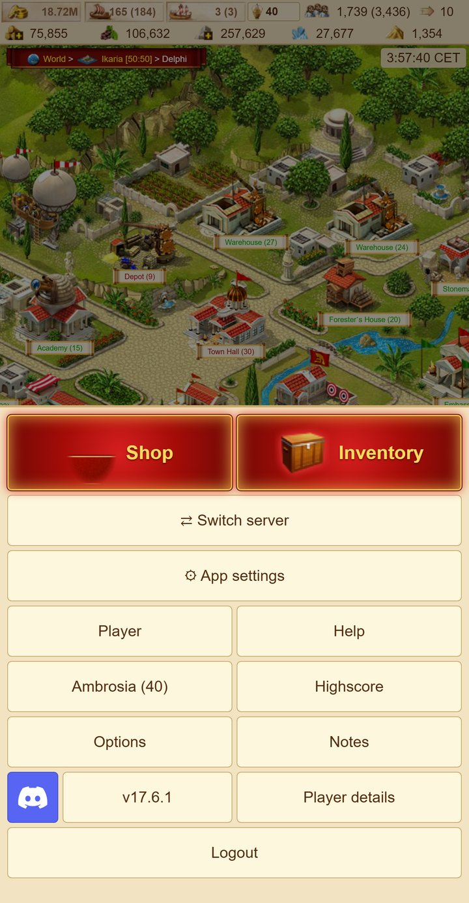
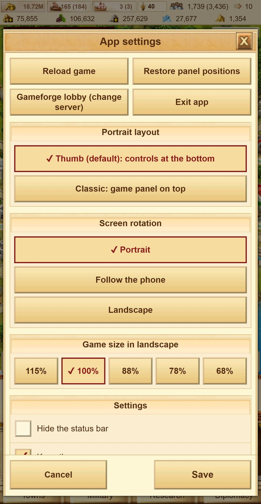

<p align="center"></p>

<p align="center">

&nbsp;
<a href="README.ar.md"></a>
</p>

<h1 align="center"> Ikariam Mobile</h1>

<p align="center"><b>Play Ikariam on your phone, comfortably, with one thumb.</b><br>
The real game, laid out for a phone in portrait. Unofficial fan project.</p>

<p align="center">
<a href="https://github.com/sliver301/Ikariam-Mobile-APP/releases/latest"></a>
</p>

<p align="center">

<br><sub>The touch controls in 75 seconds · <a href="https://github.com/sliver301/Ikariam-Mobile-APP/releases/download/v1.1/Ikariam-Mobile-tutorial-en.mp4">full-quality video</a></sub>
</p>

<p align="center">



</p>
<p align="center">



</p>
<p align="center"><sub>Town and player names are made up.</sub></p>

## What you get

- 👍 **Everything in thumb reach:** a slim strip on top; the town bar, City / Island / World / More and the advisors at the bottom.
- 🎡 **Town wheel:** slide or flick through your towns, tap one to go there.
- 🗺️ **World map bar:** jump to coordinates, and keep a list of saved islands.
- 🔔 **News alerts:** the advisor's news on your lock screen, with the text itself.
- ✋ **Touch made for the game:** drag the map, pinch to zoom, hold for info, easy sliders and building moves.
- 🌍 **Your language:** follows the game's language (27 languages), mirrored for Arabic and Hebrew.
- 🔄 **Updates itself:** offers each new version when you open it.

Every game action comes from your own tap: the app never plays for you.

<details>
<summary><b>All features</b></summary>

**Made for your thumb (portrait)**
- A slim strip on top (gold, ships, Ambrosia, citizens, action points, resources, the server clock); the town bar,
  City / Island / World / More and the advisors at the bottom.
- **Town wheel:** slide the town bar, or flick it to spin through your towns; it rests with one town in the middle
  and never switches by itself. Tap the ringed town, or the town just beside it, to go there at once. Your own town
  stays marked, and a tag above the bar takes you back. Small notches can be felt while it turns (can be turned off).
- **Town menu and Social** buttons: press to show or hide the column, or slide up and let go on the item you want.
  In an alliance, Social holds the alliance chat and alliance message on top of your friends.
- Game windows fill the screen's width; windows and side panels can be dragged by their top bar and remember where
  you left them. The alliance chat is full width with text twice the game's size.
- Towns open on their Town Hall; the island view and the world map open with your town / island in the middle.
- **World map bar:** X / Y boxes (Next goes to the other box, then Go jumps there and selects the island) and the
  game's island shortcut list as a dropdown: your towns' islands, then the islands you saved, each with its
  resource, name and coordinates. ★ saves the selected island (with your own name), ✕ removes one.
- **More:** the shop, inventory, Discord, switch server (straight to any server you play on this phone), the game's
  links and **App settings**: a window in the game's style with layout, rotation, the switches, reload, lobby, the
  tutorial and more.
- Any server, any language: the app follows the language you choose in the game's Options (27 languages), mirrored
  for Arabic and Hebrew.
- Town list > Edit order: your own town order, saved to the game's custom sorting so it applies everywhere.
- A classic layout (game panel on top) and landscape are available too.

**Touch controls**
- Tap = click. Hold = the game's hover info (on gold or a resource it shows large, just above the town bar; any
  touch or Back closes it). Hold and move = drag.
- Drag the city and island with one finger; pinch or double-tap zooms the map only, never the bars.
- Two fingers inside a window (for example a battle report) zoom its content.
- Number boxes open the number pad (always English digits), with the cursor after the last digit.
- Sliders: take the knob from a wide band around it or slide along the track; a small tick on every step.
- Rearrange buildings: the building moves under your thumb; on a free place a green ring pulses and the phone
  buzzes. Save saves, Back cancels.
- Back closes what is on top; with nothing open, Back twice leaves the app.

**Touch tutorial**
- Offered once after installing, and always under More > App settings. It plays on a saved copy of a town (no
  personal details), full screen, and cannot touch your account. Back twice ends it.

</details>

<details>
<summary><b>News alerts</b> (optional, on by default)</summary>

- Every minute it checks each server you are logged in to for advisor news (towns, military, research, diplomacy)
  and vibrates (no sound). The alert shows the news itself (town and text) with the advisor's picture; tap it to
  open that server at that advisor. News the app read for you stays highlighted in the game until you have looked.
- It never logs in by itself. If you were logged out (for example by playing on a PC), it says so once, with a
  Reconnect button.
- Note: background checks may not be allowed by the game's rules; use at your own risk. Turn them off in App
  settings.

</details>

<details>
<summary><b>How it works</b> · install · updates</summary>

It is a dedicated browser: it loads the real Ikariam website and only changes how the page is laid out and how
touch reaches it. Every game action comes from your own tap. It is an unofficial fan project and is not affiliated
with Gameforge.

**Install:** download the APK from the [latest release](https://github.com/sliver301/Ikariam-Mobile-APP/releases/latest),
open it on your phone and allow installing from that app when Android asks. Android 12 or newer. Log in with your
Gameforge account as usual and pick your server; the app remembers it.

**Updates:** the app checks this page when it opens and offers to download and install a newer release for you.
Version numbers follow the game: app 1.17.6.1 is made for game version 17.6.1 (1.17.6.1.1 is the app's second release
for that game version). When the game moves to a new version, the app tells you once, in case something looks
different until the app catches up.

</details>

<details>
<summary><b>For developers</b></summary>

```
app/src/main/java/com/islam/ikariamtouch/   Android side (WebView, back button, settings, alerts, tutorial)
app/src/main/assets/enhance.js               Page script: layout, touch handling, map camera, town wheel
app/src/main/assets/i18n.txt                 The app's own words in every language
app/src/main/assets/tutorial/                The tutorial's captions (its saved town is built locally)
art/                                         Scripts to build the extended city background
build.bat / build_public.bat                 Local build / the build for releases
```

Requirements: JDK 17+ (Android Studio's bundled JBR works), Android SDK (compileSdk 37), Gradle 9.6. Run
`gradle assembleDebug` or edit the paths in `build.bat`; the APK is written to
`app/build/outputs/apk/debug/app-debug.apk`.

The game's own pictures and pages are not in this repository: the extended city background
(`app/src/main/assets/art/`) and the tutorial's saved town (`app/src/main/assets/tutorial/tut_*.html`) are built
locally from a running game, and a build without them falls back to a mirrored city edge and the written help. The
release APK includes them.

**Extended city background:** with the app running on a phone (USB debugging), collect the city's ground tiles into
`art/source/`, run `art/make_gemini_inputs.ps1`, have an image model fill the grey area upward, save the result in
`art/generated/` and install it with `art/install_generated.ps1 -Picture art/generated/<file>`.

The app icon is original artwork (`art/make_icon.py` builds it from `art/icon_source.png`).

</details>

<sub>Ikariam and its artwork are trademarks / property of Gameforge 4D GmbH. This project only provides a browser
wrapper for personal use; please follow the game's terms of service.</sub>
